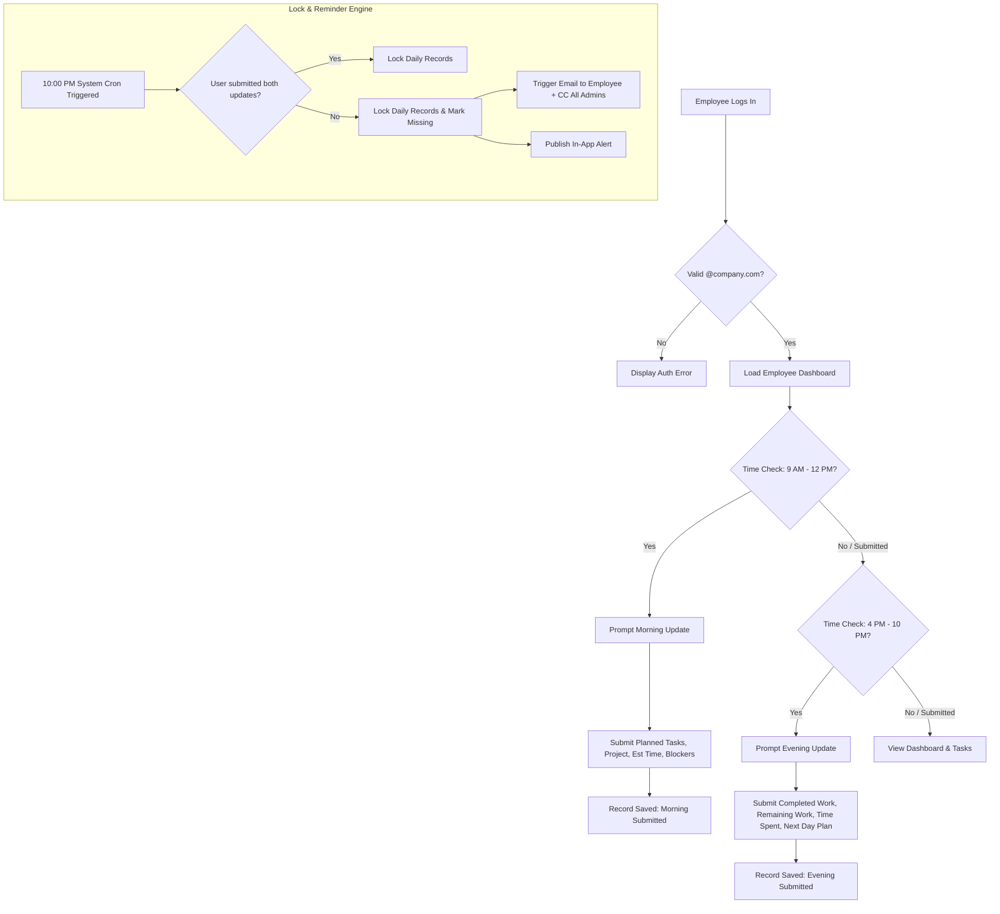
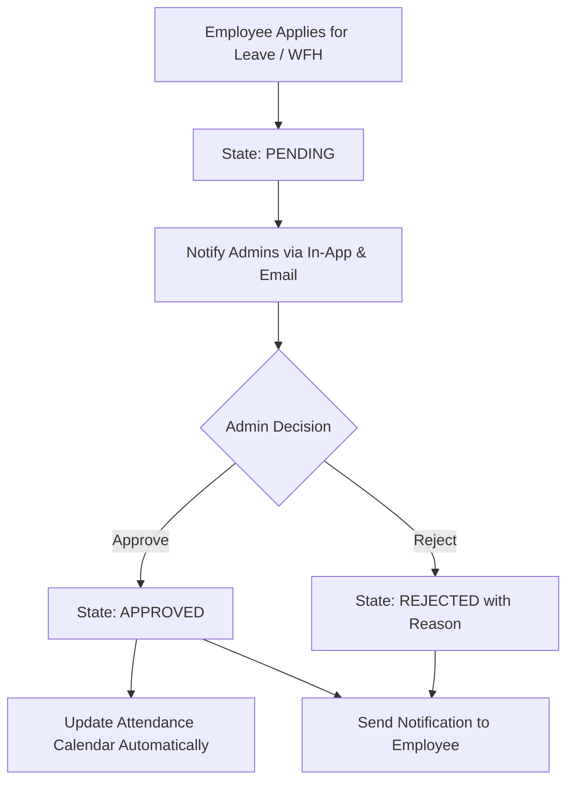
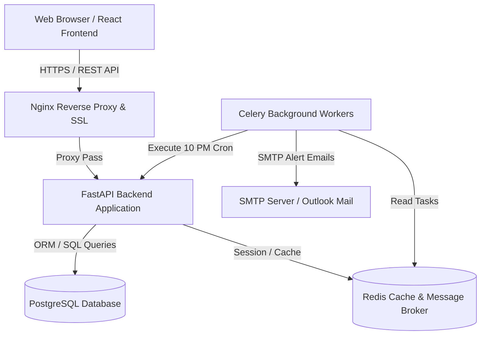

# Software Requirements Specification (SRS)
## Daily Work Tracker - Enterprise Work Update & Productivity Management System

**Document Version:** 1.0.0  
**Status:** Approved / Implementation-Ready  
**Date:** July 29, 2026  
**Author:** Senior Software Architect & Technical Lead  
**Target Audience:** Engineering Leads, Software Developers, UI/UX Designers, QA Engineers, DevOps Engineers, and Product Managers  

---

## 1. Executive Summary

The **Daily Work Tracker** is an enterprise-grade, web-based employee task management, status tracking, and productivity monitoring platform designed for modern organizations. In hybrid and distributed work environments, organizations struggle with visibility into daily deliverables, blocker resolution, project timeline tracking, and accurate attendance accounting.

The platform establishes a disciplined twice-daily work reporting workflow:
- **Morning Update (9:00 AM – 12:00 PM):** Employees set daily commitments, select projects/tasks, record initial status, estimated completion time, and signal potential blockers.
- **Evening Update (4:00 PM – 10:00 PM):** Employees report actual progress, remaining work, time spent, challenges encountered, and preliminary plans for the next working day.

At **10:00 PM**, daily reports lock to prevent retroactive tampering, and an automated notification engine scans for missing submissions, triggering targeted email reminders to delinquent employees with CC to all system Administrators. The platform unifies work updates, project management, interactive calendar tracking, working-day attendance calculations (excluding weekends and corporate holidays), leave/WFH approvals, audit logging, and automated reporting into a cohesive user experience.

---

## 2. Objectives

- **Operational Transparency:** Provide real-time visibility into active employee tasks, planned deliverables, and actual completions across projects.
- **Disciplined Daily Cadence:** Enforce structured morning commitment logging and evening wrap-up reporting.
- **Automated Accountability:** Automated 10:00 PM detection of missing updates, issuing multi-recipient email reminders (Employee + CC Admins) and in-app alerts.
- **Integrated Attendance & Work Location Tracking:** Track Present, Absent, Leave, WFH, Half-Day, and Late Login statuses, accurately computing net working days by excluding Saturdays, Sundays, and corporate holidays.
- **Project Progress Monitoring:** Enable Admins to monitor project progress percentages, milestones, overdue tasks, active/inactive contributors, and productivity graphs.
- **Enterprise Security & Compliance:** Enforce strict company-domain email authentication (`@company.com`), role-based access control (RBAC), session timeout management, and complete immutable audit logging.

---

## 3. User Roles & System Permissions

The platform implements Role-Based Access Control (RBAC) with two primary roles. The system supports multiple users with the `Admin` role, all possessing equal administrative privileges.

| Privilege / Action | Admin | Employee / User |
| :--- | :---: | :---: |
| Authenticate via Official Email (`@company.com`) | Yes | Yes |
| Reset & Change Password, Session Timeout, Remember Me | Yes | Yes |
| Submit Morning & Evening Updates (Self) | Yes | Yes |
| Edit Own Updates (Before 10:00 PM Lock) | Yes | Yes |
| View Personal Dashboard, Assigned Projects, & Tasks | Yes | Yes |
| Apply for Leave & Work From Home (WFH) | Yes | Yes |
| View Personal Attendance & Interactive Calendar | Yes | Yes |
| Create & Update Personal Tasks | Yes | Yes |
| Create, Edit, & Archive Projects | Yes | Manual view only |
| Assign Employees to Projects & Set Milestones | Yes | No |
| Approve / Reject Leave & WFH Requests with Comments | Yes | No |
| View Organization-Wide Dashboard & Analytics | Yes | No |
| View All Employee Attendance, Reports & Audit Logs | Yes | No |
| Receive CC on Automated Missed Update Emails | Yes | No |

---

## 4. Functional Requirements

### 4.1 Authentication & Authorization Module
- **FR-AUTH-001 (Company Email Restriction):** Authentication is strictly restricted to valid corporate email domains (`@company.com`). Personal email domains (`@gmail.com`, `@yahoo.com`) are rejected during login and registration.
- **FR-AUTH-002 (Secure Login):** Login requires email and password encrypted via Argon2/bcrypt. Supports optional "Remember Me" (30-day extended refresh token).
- **FR-AUTH-003 (Password Management):** Includes Self-Service Password Reset via time-sensitive HMAC tokens sent to corporate email, and authenticated Change Password functionality requiring current password verification.
- **FR-AUTH-004 (Session Governance):** Automatic session timeout after 15 minutes of inactivity (configurable). Token refresh mechanism handles seamless JWT renewal.
- **FR-AUTH-005 (RBAC Enforcement):** API endpoints and UI routes enforce role permissions. Unprivileged users accessing Admin routes receive standard HTTP 403 Forbidden responses.

### 4.2 Employee Daily Work Update Module
- **FR-UPD-001 (Morning Update Capture):** Window: 9:00 AM – 12:00 PM. Required fields: Project selection, Task selection, Planned Work description, Current Status (Not Started, In Progress, Blocked), Estimated Completion Time, and Blockers (optional text).
- **FR-UPD-002 (Evening Update Capture):** Window: 4:00 PM – 10:00 PM. Required fields: Completed Work description, Remaining Work description, Time Spent (hours/minutes), Challenges Encountered (optional), Next Day Plan.
- **FR-UPD-003 (Duplicate Prevention):** System prevents submitting more than one Morning Update and one Evening Update per user per calendar date.
- **FR-UPD-004 (Edit Window & 10 PM Lock):** Users can edit submitted morning or evening reports up until 10:00 PM on the same date. At exactly 10:00:00 PM local workspace time, the report record is permanently locked for modification by non-admin users.

### 4.3 Automated Reminder & Notification System
- **FR-REM-001 (10 PM Missing Update Scan):** A scheduled background task executes daily at 10:00 PM local system time to scan all active non-leave/non-weekend users who have failed to submit both Morning and Evening updates.
- **FR-REM-002 (Automated Missed Email Alert):** Sends an HTML email to the delinquent Employee, with **CC to all system Admins**. Email includes missing report type, date, assigned pending tasks, and warning message.
- **FR-REM-003 (In-App Notification Engine):** Real-time in-app notification center alerts users to pending submissions, leave approvals/rejections, task assignments, and project milestone updates.
- **FR-REM-004 (Extensible Webhook Architecture):** System architecture includes integration hooks for future Slack and Microsoft Teams notification dispatchers.

### 4.4 Project & Task Management Module
- **FR-PRJ-001 (Project Lifecycle):** Admins can Create, Edit, Archive, and set status (`Planning`, `In Progress`, `On Hold`, `Completed`, `Archived`) for projects.
- **FR-PRJ-002 (Project Attributes):** Project Name, Description, Start Date, End Date, Priority (`Low`, `Medium`, `High`, `Critical`), Assigned Employees, Milestones, Progress %, Overdue Task count.
- **FR-TSK-001 (Task Creation & Lifecycle):** Users/Admins create tasks linked to specific projects with Priority (`Low`, `Medium`, `High`, `Critical`) and Status (`Not Started`, `In Progress`, `Blocked`, `Completed`).
- **FR-TSK-002 (Task Reopening):** Admins and Task Assignees can reopen completed tasks with mandatory justification comments.

### 4.5 Attendance, Leave & WFH Management
- **FR-ATT-001 (Attendance Classification):** Daily attendance is classified as `Present`, `Absent`, `Leave`, `Work From Home (WFH)`, `Half Day`, or `Late Login`.
- **FR-ATT-002 (Working Day Logic):** Working days calculation excludes Saturdays, Sundays, and corporate holidays configured in the System Calendar.
- **FR-LVE-001 (Leave & WFH Requests):** Employees apply for Leave or WFH specifying type, start date, end date, and reason. Employees can cancel pending requests.
- **FR-LVE-002 (Admin Approval Workflow):** Admins review pending requests with actions to Approve or Reject with comments. State changes generate instant email/in-app notifications.

### 4.6 Reporting & Audit Engine
- **FR-REP-001 (Multi-Granularity Reporting):** Generate Daily, Weekly, Monthly, and Yearly reports covering attendance, task completion %, productivity trends, and project health.
- **FR-REP-002 (Export Capabilities):** Export any grid or analytical view to Excel (`.xlsx`), CSV (`.csv`), or printable PDF (`.pdf`).
- **FR-AUD-001 (Immutable Audit Log):** Log every critical system event (Login, Logout, Task Create/Update, Leave Request/Approval, Project Change, Admin Action) with User ID, Timestamp, IP Address, Action Type, and JSON Payload changes.

---

## 5. Non-Functional Requirements (NFRs)

### 5.1 Security Requirements
- **NFR-SEC-001 (Encryption):** TLS 1.3 in transit; AES-256 for sensitive database fields at rest.
- **NFR-SEC-002 (Auth Standard):** OAuth2 with JWT Bearer Access Tokens (15 min expiry) and HTTP-Only Secure Refresh Tokens (7-30 days expiry).
- **NFR-SEC-003 (Password Hashing):** Argon2id or bcrypt (cost factor >= 12).
- **NFR-SEC-004 (OWASP Top 10 Mitigation):** Strict input sanitization, parameterized SQL queries via SQLAlchemy ORM, Content Security Policy (CSP), CORS domain whitelist.

### 5.2 Scalability & Performance
- **NFR-PER-001 (Response Time):** 95th percentile API response time < 200ms for read operations; < 500ms for complex report generations.
- **NFR-PER-002 (Concurrency):** Support 1,000 active concurrent user sessions without degrade in page responsiveness.
- **NFR-PER-003 (Background Processing):** Celery + Redis task queue offloads email delivery, notification dispatching, and nightly 10 PM cron tasks.

### 5.3 Reliability, Availability & Disaster Recovery
- **NFR-REL-001 (Uptime SLA):** 99.9% uptime excluding scheduled maintenance.
- **NFR-REL-002 (Backup Strategy):** Daily automated PostgreSQL snapshots with WAL (Write-Ahead Logging) archiving for Point-In-Time Recovery (PITR).
- **NFR-REL-003 (RPO & RTO):** Recovery Point Objective (RPO) < 15 minutes; Recovery Time Objective (RTO) < 2 hours.

---

## 6. Complete User Workflows

### 6.1 Daily Employee Update & Lock Workflow


### 6.2 Leave & WFH Approval Workflow


---

## 7. UI/UX Screen Specifications

The UI design adheres to a high-aesthetic enterprise standard using clean glassmorphism, dynamic color-coded status badges, accessible typography (Inter / System font stack), dark mode support, and micro-interactions.

1. **Login & Auth Screen:** Clean centered card, corporate email domain validation visualizer (`@company.com`), password visibility toggle, "Remember Me" checkbox, "Forgot Password" link.
2. **Employee Dashboard:**
   - Hero greeting banner with real-time clock & lock countdown.
   - Quick Action Cards: Morning Update button (Green), Evening Update button (Blue).
   - Metrics widgets: Today's Tasks, Pending Deadlines, Leave Balance, WFH Days.
   - Recent activity list & task priority breakdown.
3. **Admin Dashboard:**
   - Top KPI Ribbon: Total Employees, Active Users Today, Pending Updates, Completed Projects, Delayed Projects.
   - Productivity Trend Line Chart (Recharts) & Task Status Bar Chart.
   - Quick Approval Queue for pending Leave / WFH applications.
   - Top Contributors & Activity Feed.
4. **Project Management Screen:**
   - Project Kanban / Grid view with progress bars, milestone progress, assigned avatar stacks, and status pills.
   - Create/Edit Project Modal with employee multi-select.
5. **Task Management Screen:**
   - Interactive Task Board grouped by Status (`Not Started`, `In Progress`, `Blocked`, `Completed`) with Priority indicators (`Low`, `Medium`, `High`, `Critical`).
6. **Interactive Attendance Calendar:**
   - Monthly grid with color-coded day badges: Morning Submitted (Green indicator), Evening Submitted (Blue indicator), Leave (Orange), WFH (Purple), Holiday (Teal), Weekend (Muted Grey).
   - Working days count dynamically calculated at bottom.
7. **Leave & WFH Management Screen:**
   - Application Form & History Table for employees.
   - Approval Matrix for Admins with inline comments and batch actions.
8. **Reports & Analytics Screen:**
   - Date range selector, project filter, employee filter.
   - Export buttons for Excel (`.xlsx`), CSV (`.csv`), and PDF (`.pdf`).
9. **Audit Logs Screen (Admin Only):**
   - Searchable, paginated audit table with filter by User, Action Type, Date, and expandable JSON details view.

---

## 8. Database Schema & ER Diagram

### 8.1 Entity Relationship Description
- **`users` 1 : N `task_updates`**: One user submits multiple daily task updates over time.
- **`users` 1 : N `attendance`**: One user has daily attendance records.
- **`users` 1 : N `leave_requests`**: One user submits multiple leave or WFH applications.
- **`projects` 1 : N `tasks`**: Projects contain multiple tasks.
- **`tasks` 1 : N `task_updates`**: Task updates link back to specific tasks and projects.
- **`roles` 1 : N `users`**: Roles (`Admin`, `Employee`) define user access levels.
- **`users` 1 : N `audit_logs`**: System actions link to executing users.

### 8.2 PostgreSQL DDL Database Schema
```sql
-- PostgreSQL Enterprise Database Schema for Daily Work Tracker

CREATE TYPE user_role_enum AS ENUM ('ADMIN', 'EMPLOYEE');
CREATE TYPE priority_enum AS ENUM ('LOW', 'MEDIUM', 'HIGH', 'CRITICAL');
CREATE TYPE task_status_enum AS ENUM ('NOT_STARTED', 'IN_PROGRESS', 'BLOCKED', 'COMPLETED');
CREATE TYPE project_status_enum AS ENUM ('PLANNING', 'IN_PROGRESS', 'ON_HOLD', 'COMPLETED', 'ARCHIVED');
CREATE TYPE attendance_status_enum AS ENUM ('PRESENT', 'ABSENT', 'LEAVE', 'WFH', 'HALF_DAY', 'LATE_LOGIN');
CREATE TYPE request_type_enum AS ENUM ('LEAVE', 'WFH');
CREATE TYPE request_status_enum AS ENUM ('PENDING', 'APPROVED', 'REJECTED', 'CANCELLED');

-- 1. Roles Table
CREATE TABLE roles (
    id SERIAL PRIMARY KEY,
    name user_role_enum NOT NULL UNIQUE,
    description TEXT,
    created_at TIMESTAMP WITH TIME ZONE DEFAULT CURRENT_TIMESTAMP
);

-- 2. Users Table
CREATE TABLE users (
    id UUID PRIMARY KEY DEFAULT gen_random_uuid(),
    role_id INT NOT NULL REFERENCES roles(id) ON DELETE RESTRICT,
    full_name VARCHAR(120) NOT NULL,
    email VARCHAR(255) NOT NULL UNIQUE,
    password_hash VARCHAR(255) NOT NULL,
    department VARCHAR(100),
    designation VARCHAR(100),
    is_active BOOLEAN DEFAULT TRUE,
    created_at TIMESTAMP WITH TIME ZONE DEFAULT CURRENT_TIMESTAMP,
    updated_at TIMESTAMP WITH TIME ZONE DEFAULT CURRENT_TIMESTAMP,
    CONSTRAINT chk_company_email CHECK (email LIKE '%@company.com')
);

-- 3. Projects Table
CREATE TABLE projects (
    id UUID PRIMARY KEY DEFAULT gen_random_uuid(),
    name VARCHAR(200) NOT NULL,
    description TEXT,
    start_date DATE NOT NULL,
    end_date DATE,
    priority priority_enum DEFAULT 'MEDIUM',
    status project_status_enum DEFAULT 'PLANNING',
    progress_percentage DECIMAL(5,2) DEFAULT 0.00,
    created_by UUID REFERENCES users(id),
    created_at TIMESTAMP WITH TIME ZONE DEFAULT CURRENT_TIMESTAMP,
    updated_at TIMESTAMP WITH TIME ZONE DEFAULT CURRENT_TIMESTAMP
);

-- 4. Project Assignments (Junction Table)
CREATE TABLE project_assignments (
    project_id UUID REFERENCES projects(id) ON DELETE CASCADE,
    user_id UUID REFERENCES users(id) ON DELETE CASCADE,
    assigned_at TIMESTAMP WITH TIME ZONE DEFAULT CURRENT_TIMESTAMP,
    PRIMARY KEY (project_id, user_id)
);

-- 5. Tasks Table
CREATE TABLE tasks (
    id UUID PRIMARY KEY DEFAULT gen_random_uuid(),
    project_id UUID NOT NULL REFERENCES projects(id) ON DELETE CASCADE,
    title VARCHAR(250) NOT NULL,
    description TEXT,
    priority priority_enum DEFAULT 'MEDIUM',
    status task_status_enum DEFAULT 'NOT_STARTED',
    assigned_to UUID REFERENCES users(id) ON DELETE SET NULL,
    due_date DATE,
    created_at TIMESTAMP WITH TIME ZONE DEFAULT CURRENT_TIMESTAMP,
    updated_at TIMESTAMP WITH TIME ZONE DEFAULT CURRENT_TIMESTAMP
);

-- 6. Task Updates Table (Morning & Evening Submissions)
CREATE TABLE task_updates (
    id UUID PRIMARY KEY DEFAULT gen_random_uuid(),
    user_id UUID NOT NULL REFERENCES users(id) ON DELETE CASCADE,
    project_id UUID REFERENCES projects(id) ON DELETE SET NULL,
    task_id UUID REFERENCES tasks(id) ON DELETE SET NULL,
    report_date DATE NOT NULL DEFAULT CURRENT_DATE,
    
    -- Morning Update Attributes
    morning_planned_work TEXT,
    morning_status task_status_enum,
    morning_est_hours DECIMAL(4,2),
    morning_blockers TEXT,
    morning_submitted_at TIMESTAMP WITH TIME ZONE,
    
    -- Evening Update Attributes
    evening_completed_work TEXT,
    evening_remaining_work TEXT,
    evening_hours_spent DECIMAL(4,2),
    evening_challenges TEXT,
    evening_next_day_plan TEXT,
    evening_submitted_at TIMESTAMP WITH TIME ZONE,
    
    is_locked BOOLEAN DEFAULT FALSE,
    created_at TIMESTAMP WITH TIME ZONE DEFAULT CURRENT_TIMESTAMP,
    CONSTRAINT unique_user_daily_report UNIQUE (user_id, report_date)
);

-- 7. Attendance Table
CREATE TABLE attendance (
    id UUID PRIMARY KEY DEFAULT gen_random_uuid(),
    user_id UUID NOT NULL REFERENCES users(id) ON DELETE CASCADE,
    date DATE NOT NULL,
    status attendance_status_enum NOT NULL DEFAULT 'PRESENT',
    login_time TIMESTAMP WITH TIME ZONE,
    logout_time TIMESTAMP WITH TIME ZONE,
    notes TEXT,
    CONSTRAINT unique_user_attendance_date UNIQUE (user_id, date)
);

-- 8. Leave & WFH Requests Table
CREATE TABLE leave_requests (
    id UUID PRIMARY KEY DEFAULT gen_random_uuid(),
    user_id UUID NOT NULL REFERENCES users(id) ON DELETE CASCADE,
    request_type request_type_enum NOT NULL,
    start_date DATE NOT NULL,
    end_date DATE NOT NULL,
    reason TEXT NOT NULL,
    status request_status_enum DEFAULT 'PENDING',
    reviewed_by UUID REFERENCES users(id),
    admin_comment TEXT,
    created_at TIMESTAMP WITH TIME ZONE DEFAULT CURRENT_TIMESTAMP,
    updated_at TIMESTAMP WITH TIME ZONE DEFAULT CURRENT_TIMESTAMP
);

-- 9. Notifications Table
CREATE TABLE notifications (
    id UUID PRIMARY KEY DEFAULT gen_random_uuid(),
    user_id UUID NOT NULL REFERENCES users(id) ON DELETE CASCADE,
    title VARCHAR(200) NOT NULL,
    message TEXT NOT NULL,
    is_read BOOLEAN DEFAULT FALSE,
    link VARCHAR(255),
    created_at TIMESTAMP WITH TIME ZONE DEFAULT CURRENT_TIMESTAMP
);

-- 10. Audit Logs Table
CREATE TABLE audit_logs (
    id UUID PRIMARY KEY DEFAULT gen_random_uuid(),
    user_id UUID REFERENCES users(id) ON DELETE SET NULL,
    action_type VARCHAR(100) NOT NULL,
    ip_address VARCHAR(45),
    details JSONB,
    created_at TIMESTAMP WITH TIME ZONE DEFAULT CURRENT_TIMESTAMP
);
```

---

## 9. REST API Specification

| Endpoint | Method | Role | Description |
| :--- | :--- | :--- | :--- |
| `/api/v1/auth/login` | POST | Public | Authenticate user & issue JWT access + refresh tokens |
| `/api/v1/auth/refresh` | POST | Public | Refresh expired access token |
| `/api/v1/auth/forgot-password` | POST | Public | Trigger password reset email link |
| `/api/v1/auth/reset-password` | POST | Public | Execute password reset with HMAC token |
| `/api/v1/updates/morning` | POST | User/Admin | Submit Morning Update (9 AM - 12 PM) |
| `/api/v1/updates/evening` | POST | User/Admin | Submit Evening Update (4 PM - 10 PM) |
| `/api/v1/updates/today` | GET | User/Admin | Fetch today's update lock status and content |
| `/api/v1/projects` | GET/POST | User (GET), Admin (All) | List and Create Projects |
| `/api/v1/projects/{id}` | PUT/DELETE | Admin | Update or Archive Project |
| `/api/v1/tasks` | GET/POST | User/Admin | List, Create, and Update Tasks |
| `/api/v1/attendance/my` | GET | User/Admin | Fetch personal attendance & calendar events |
| `/api/v1/leave/apply` | POST | User/Admin | Apply for Leave or WFH |
| `/api/v1/leave/manage/{id}`| PUT | Admin | Approve or Reject Leave request with comment |
| `/api/v1/admin/dashboard` | GET | Admin | Fetch executive metrics, graphs, and top contributors |
| `/api/v1/reports/export` | GET | Admin | Export Daily/Weekly/Monthly reports in Excel/CSV/PDF |
| `/api/v1/admin/audit-logs` | GET | Admin | Fetch system audit logs with filters |

---

## 10. Notification & Automated 10 PM Email Flow

### Email Template: Missing Update Notification
- **Subject:** `[ACTION REQUIRED] Missing Daily Work Update - {Date} | {Employee Name}`
- **To:** `{employee.email}`
- **CC:** `admin1@company.com, admin2@company.com`
- **Body HTML:**
```html
<div style="font-family: Arial, sans-serif; background-color: #f4f6f8; padding: 20px;">
  <div style="max-width: 600px; background: #ffffff; border-radius: 8px; padding: 30px; border-top: 4px solid #ef4444;">
    <h2 style="color: #1e293b;">Daily Work Tracker - Missing Update Alert</h2>
    <p>Dear <strong>{{employee_name}}</strong>,</p>
    <p>Our automated monitoring system detected that you have not submitted your required daily work updates for <strong>{{report_date}}</strong> before the 10:00 PM lock window.</p>
    <table style="width: 100%; border-collapse: collapse; margin: 20px 0;">
      <tr style="background: #f8fafc;"><td style="padding: 10px; border: 1px solid #e2e8f0;">Missing Submission:</td><td style="padding: 10px; border: 1px solid #e2e8f0; font-weight: bold; color: #ef4444;">{{missing_type}}</td></tr>
      <tr><td style="padding: 10px; border: 1px solid #e2e8f0;">Pending Tasks:</td><td style="padding: 10px; border: 1px solid #e2e8f0;">{{pending_tasks_count}} Tasks Assigned</td></tr>
    </table>
    <p>Please note that this missed update has been logged in the system audit records and notified to all System Administrators.</p>
    <div style="margin-top: 25px; font-size: 12px; color: #64748b;">Daily Work Tracker Automated Notification System. Please do not reply directly to this email.</div>
  </div>
</div>
```

---

## 11. System Architecture & Sequence Diagrams

### 11.1 High-Level Architecture Diagram


---

## 12. Deployment Architecture & Docker Stack

The system is deployed as a multi-container Docker Compose environment:
- **`frontend` Container:** Nginx serving production-built static React SPA bundle on port 80/443.
- **`backend` Container:** Uvicorn running ASGI FastAPI app on internal port 8000.
- **`db` Container:** PostgreSQL 16 image with persistent volume storage.
- **`redis` Container:** Redis 7 alpine in-memory broker.
- **`celery_worker` & `celery_beat` Containers:** Execute scheduled daily 10 PM check and async email tasks.

---

## 13. Folder Structure & Codebase Organization

```
tracker/
├── docs/
│   └── SRS.md                       # Comprehensive Software Requirements Specification
├── database/
│   └── schema.sql                   # Complete PostgreSQL DDL Script
├── backend/
│   ├── app/
│   │   ├── api/v1/                  # FastAPI API Endpoint Routers
│   │   ├── core/                    # Security, Config & Auth Helpers
│   │   ├── db/                      # SQLAlchemy Engine & Session Setup
│   │   ├── models/                  # SQLAlchemy ORM Data Models
│   │   ├── schemas/                 # Pydantic Input/Output Schemas
│   │   ├── services/                # Business Logic & Reminder Engines
│   │   ├── tasks/                   # Celery Asynchronous & Cron Tasks
│   │   └── main.py                  # FastAPI Application Entry Point
│   ├── Dockerfile
│   └── requirements.txt
├── frontend/
│   ├── src/
│   │   ├── components/              # Reusable UI Components & Modals
│   │   ├── context/                 # Application Context & Auth Store
│   │   ├── pages/                   # Main Page Views (Dashboard, Projects, Tasks, etc.)
│   │   ├── types/                   # TypeScript Type Interfaces
│   │   ├── App.tsx                  # Core App Component & Routing
│   │   └── main.tsx                 # React DOM Mount
│   ├── package.json
│   └── vite.config.ts
├── docker-compose.yml               # Multi-container Deployment Manifest
└── README.md                        # Master Documentation & Setup Guide
```

---

## 14. Development Roadmap

- **Phase 1 (Sprint 1-2):** Core Database DDL, FastAPI Auth endpoints, Role setup, React layout & design system.
- **Phase 2 (Sprint 3-4):** Daily Work Updates (Morning & Evening), 10 PM locking rules, Celery Redis email notification engine.
- **Phase 3 (Sprint 5-6):** Project & Task Management modules, Interactive Calendar, Leave & WFH approval workflow.
- **Phase 4 (Sprint 7-8):** Admin Analytics Dashboard, Report Generators (CSV/Excel/PDF), Audit Logging, Security Hardening & End-to-End Testing.

---

## 15. Risks & Assumptions

- **Risk 1 (Email Delivery Failures):** SMTP rate limits or spam filters could prevent 10 PM notifications.  
  *Mitigation:* Implement Celery automatic retries with exponential backoff and log failure events in `email_logs`.
- **Risk 2 (Timezone Drift):** Employees working across multiple timezones might face incorrect 10 PM lock triggers.  
  *Mitigation:* Store all timestamps in UTC and convert to workspace-configured local timezone for daily lock computations.
- **Assumption:** Users have standard browser access (Chrome, Edge, Firefox, Safari) and valid corporate `@company.com` email addresses.

---

## 16. Future Enhancements

1. **AI-Generated Daily Summaries & Productivity Scoring:** LLM integration to auto-summarize daily updates for executive reporting.
2. **Microsoft Teams & Slack Bots:** Native bot integrations for submitting morning/evening updates directly via chat commands.
3. **Mobile Native Apps:** iOS and Android Flutter/React Native builds with push notifications.
4. **Third-Party Integrations:** Jira task synchronization, GitHub commit/PR automated linking, and Outlook calendar sync.
